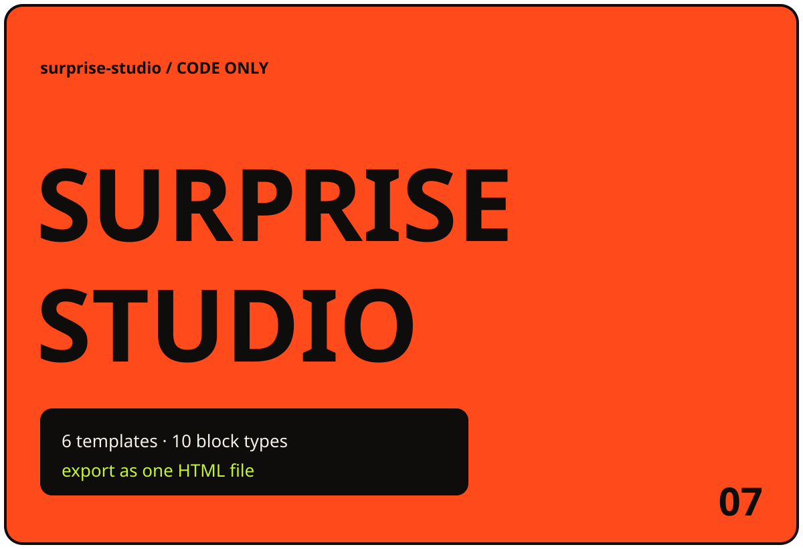

<a href="https://ifeanyi-obioma.vercel.app">
  <picture>
    <source media="(prefers-color-scheme: dark)" srcset="assets/banner-dark.svg">
    
  </picture>
</a>

<p align="center">
  <a href="https://ifeanyi-obioma.vercel.app"></a>
  <a href="https://www.linkedin.com/in/ifeanyi-obioma-75532633b/"></a>
  <a href="mailto:shuwabel@outlook.com"></a>
</p>

```ts
const ifeanyi = {
  based: "Abuja, Nigeria",
  studied: "B.Sc. Computer Science, Nile University of Nigeria (2021 to 2025)",
  lately: "Software engineering intern on KeepDots, OrgByte Builders Program (2026)",
  writes: ["TypeScript", "JavaScript", "Python", "Dart", "SQL"],
  ships: ["web apps", "mobile apps", "landing pages that move"],
  learning: "AI and machine learning (TerraSkills certificate, 2026)",
  hire: "shuwabel@outlook.com",
};
```

## The work

Most of these run right in your browser with sample data. No sign-up needed to look around.

<table>
<tr>
<td width="50%" valign="top">
<a href="https://crowdfund-africa-gilt.vercel.app"></a>

### FundAfrica
Crowdfunding for African community projects. Every campaign publishes its budget line by line, and each milestone unlocks only when its money is in.

`Next.js 16` `React 19` `Tailwind 4` `Zustand` `Vitest`

[**Open it ↗**](https://crowdfund-africa-gilt.vercel.app) · [Code](https://github.com/Shuwabel/crowdfund-africa)
</td>
<td width="50%" valign="top">
<a href="https://fresh-plate-theta.vercel.app"></a>

### FreshPlate
A library of 61 African dishes, 36 of them Nigerian. Filter by what is in your kitchen, scale servings, cook with a step timer, plan a week and send the shopping list to WhatsApp.

`Next.js` `Zustand` `shadcn/ui` `Zod` `Vitest`

[**Open it ↗**](https://fresh-plate-theta.vercel.app) · [Code](https://github.com/Shuwabel/FreshPlate)
</td>
</tr>
<tr>
<td width="50%" valign="top">
<a href="https://study-timesync.vercel.app"></a>

### StudySync
Give it your courses and exam dates. It plans every study day backwards from the exam, lets you tick sessions off, and exports to PDF or your calendar.

`React` `Vite` `Tailwind` `dnd-kit` `date-fns` `jsPDF`

[**Open it ↗**](https://study-timesync.vercel.app) · [Code](https://github.com/Shuwabel/study-timesync)
</td>
<td width="50%" valign="top">
<a href="https://student-tutor-platform.vercel.app"></a>

### Student Tutor Platform
A learning platform with three working roles: student, tutor and admin. Courses, timed quizzes, graded assignments, live classes and certificates anyone can verify by link.

`Next.js` `Zustand` `jsPDF` `date-fns` `Vitest`

[**Open it ↗**](https://student-tutor-platform.vercel.app) · [Code](https://github.com/Shuwabel/Student-Tutor-Platform)
</td>
</tr>
<tr>
<td width="50%" valign="top">
<a href="https://brand-landing-page-khaki.vercel.app"></a>

### Okay Brand
An editorial scroll landing page for a menswear label: kinetic cover, a manifesto that lights up word by word, a sideways studio rail and a pinned lookbook with hotspots.

`Next.js` `GSAP` `Lenis` `Tailwind`

[**Open it ↗**](https://brand-landing-page-khaki.vercel.app) · [Code](https://github.com/Shuwabel/brand-landing-page)
</td>
<td width="50%" valign="top">
<a href="https://blockchain-validation-bay.vercel.app"></a>

### Budget Transparency
Public spending, on the record. Portals for officials, contractors and citizens, with Solidity contracts written to log each disbursement on chain.

`Next.js` `Supabase` `Solidity` `ethers.js` `Recharts`

[**Open it ↗**](https://blockchain-validation-bay.vercel.app) · [Code](https://github.com/Shuwabel/blockchain-validation)
</td>
</tr>
<tr>
<td colspan="2" valign="top">
<a href="https://github.com/Shuwabel/surprise-studio"></a>

### Surprise Studio
A no-code page maker for birthdays, invitations and Girlfriend's Day. Six templates, ten block types you can drag around, eight themes with contrast checks, a hundred steps of undo, and the finished page exports as one self-contained HTML file.

`Vite` `React` `TypeScript` `IndexedDB` `Vitest`

[**Code ↗**](https://github.com/Shuwabel/surprise-studio)
</td>
</tr>
</table>

## The road so far

<picture>
  <source media="(prefers-color-scheme: dark)" srcset="assets/timeline-dark.svg">
  
</picture>

## The toolbox

<p align="center">
  <br/>
  <br/>
  <br/>
  
</p>

## Watch it eat my commits

<picture>
  <source media="(prefers-color-scheme: dark)" srcset="https://raw.githubusercontent.com/Shuwabel/Shuwabel/output/snake-dark.svg">
  
</picture>

<p align="center">
  <a href="mailto:shuwabel@outlook.com?subject=Let%27s%20build%20something"><b>Got something to build? Hire me ↗</b></a>
</p>
